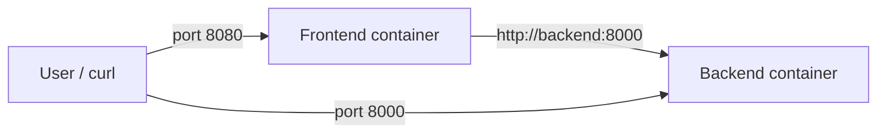

# Parallax Labs DevOps Internship (Track B)

This repo has my work for the 6-week DevOps internship.
I use one repo for all weeks and update this README every week.

**Current progress:** Week 1 - Microservices and Containerization 

---

## What I built in Week 1

Two small microservices in Python (FastAPI), each running in its own Docker container:

- **Backend**: JSON API on port `8000`
- **Frontend**: web page on port `8080` that calls the backend

Both have `/health` and `/info` endpoints.

## Architecture



## Folder structure

```
.
├── services/
│   ├── frontend/    # app/main.py, Dockerfile, requirements.txt, .dockerignore
│   └── backend/     # app/main.py, Dockerfile, requirements.txt, .dockerignore
└── README.md
```

## Tool versions

| Tool | Version |
|------|---------|
| Docker | Docker version 29.9.2, build a82e528 |
| kubectl | Client Version: v1.36.1 (Kustomize v5.8.1) |
| Helm | v4.3.2+g8346aaa |
| Terraform | Terraform v1.17.2 on windows_amd64 |

## Endpoints

| Service | Port | Endpoints |
|---------|------|-----------|
| Backend | 8000 | `/health`, `/info`, `/api/items` |
| Frontend | 8080 | `/`, `/health`, `/info` |

## How the Dockerfiles work

- **Multi-stage build:** stage 1 installs the Python packages, stage 2 copies only what is needed. This keeps the final image small.
- **Light base image:** `python:3.12-slim`.
- **Non-root user:** both images run as `USER 1001`.
- **.dockerignore:** keeps cache, git and venv files out of the image.
- **Pinned versions** in `requirements.txt`, so builds are the same every time.

## How to run (PowerShell)

```powershell
# 1. Build both images
docker build -t microservices/backend:1.0.0 services\backend
docker build -t microservices/frontend:1.0.0 services\frontend

# 2. Create a network so frontend can find backend by name
docker network create appnet

# 3. Run both containers
docker run -d --name backend --network appnet -p 8000:8000 microservices/backend:1.0.0
docker run -d --name frontend --network appnet -p 8080:8080 -e BACKEND_URL=http://backend:8000 microservices/frontend:1.0.0

# 4. Check
docker ps
```

Then open http://localhost:8080 in the browser.

To stop everything:

```powershell
docker rm -f backend frontend
docker network rm appnet
```

## Test results

```text
curl.exe localhost:8000/health
{"status":"ok"}

curl.exe localhost:8000/info
{"service":"backend","version":"1.0.0","hostname":"c48e5609269c","uptime_seconds":1951}

curl.exe localhost:8080/health
{"status":"ok"}

curl.exe localhost:8080/info
{"service":"frontend","version":"1.0.0","hostname":"110d3157979c","uptime_seconds":363}
```

Non-root check:

```text
docker exec backend id
uid=1001 gid=0(root) groups=0(root)

docker exec frontend id
uid=1001 gid=0(root) groups=0(root)
```

Both containers run as user `1001`, not root.

## Image sizes

```text
microservices/backend:1.0.0     200MB (content size 48.5MB)
microservices/frontend:1.0.0    200MB (content size 48.5MB)
```

## Notes

- The frontend finds the backend using the Docker network name `backend`.
- `/health` has no dependencies, so it can be used for Kubernetes probes later.
- My first backend build failed because of a pip download timeout (slow internet). I fixed it by pinning package versions and adding `--default-timeout=100 --retries=5` to the pip command in the Dockerfile.
- Next week: Kubernetes (Minikube/Kind), Helm chart and Istio mTLS.