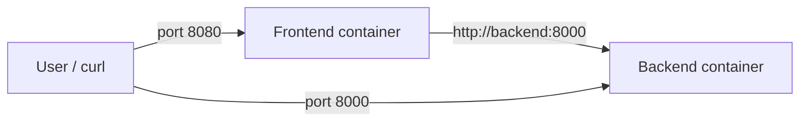

# 🚀 Parallax Labs DevOps Internship (Track B)

This repo holds my work for the 6-week DevOps internship.
I use **one repo for all weeks** and update this README every week.

**Current progress:** ✅ Week 1 – Microservices & Containerization

---

## 📌 What I built in Week 1

Two small microservices written in Python (FastAPI), each running in its own Docker container:

- **Backend** → JSON API on port `8000`
- **Frontend** → web page on port `8080` that calls the backend

Both have `/health` and `/info` endpoints.

## 🏗️ Architecture



## 📁 Folder structure

```
.
├── services/
│   ├── frontend/    # web server (app/main.py, Dockerfile, requirements.txt)
│   └── backend/     # JSON API  (app/main.py, Dockerfile, requirements.txt)
├── scripts/         # build.sh, run.sh, verify.sh, cleanup.sh
└── README.md
```

## 🧰 Tool versions

| Tool | Command | Version |
|------|---------|---------|
| Docker | `docker --version` | _paste here_ |
| kubectl | `kubectl version --client` | _paste here_ |
| Helm | `helm version --short` | _paste here_ |
| Terraform | `terraform version` | _paste here_ |

## 🌐 Endpoints

| Service | Port | Endpoints |
|---------|------|-----------|
| Backend | 8000 | `/health`, `/info`, `/api/items` |
| Frontend | 8080 | `/`, `/health`, `/info` |

## 🐳 How the Dockerfiles work

- **Multi-stage build:** stage 1 installs packages, stage 2 copies only what is needed. This keeps the image small.
- **Light base image:** `python:3.12-slim`.
- **Non-root user:** both images run as `USER 1001` for security 🔒.
- **.dockerignore:** stops unneeded files (cache, git, venv) from going into the image.

## ▶️ How to run

```bash
./scripts/build.sh     # build both images
./scripts/run.sh       # start both containers
./scripts/verify.sh    # test with curl
./scripts/cleanup.sh   # stop and remove everything
```

Then open http://localhost:8080 in the browser.

## ✅ Test results

Output of `./scripts/verify.sh`:

```text
paste output here
```

Image sizes (`docker images | grep microservices`):

```text
paste output here
```

## 📝 Notes

- The frontend finds the backend using the Docker network name `backend`.
- `/health` has no dependencies, so it can be used for Kubernetes probes later.
- Next week: Kubernetes, Helm and Istio mTLS.
